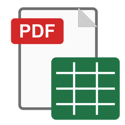

# PDF в XLSX



Перетворює PDF із таблицями (збережені з Word чи Excel документи, додатки до наказів, відомості) на Excel-файл **з тією самою розміткою**. Ширини колонок, висоти рядків, об'єднані клітинки, рамки, шрифти, вирівнювання, поля сторінки, розриви сторінок і печатки стоять на своїх місцях.

## Як користуватися

1. Завантажте `PDF в XLSX.exe` з розділу [Releases](../../releases). Встановлювати нічого не треба, Office теж не потрібен.
2. Перетягніть PDF у вікно програми або на сам exe. Можна кілька файлів чи цілу теку.
3. Поруч із кожним PDF з'явиться `.xlsx` з тим самим ім'ям. Якщо такий файл уже є, новий буде з « (2)», старий не перезаписується.

## Що підтримується

- PDF з текстовим шаром: усе, що збережене з Word, Excel чи LibreOffice.
- Таблиці з рамками: сітка відновлюється з векторних ліній PDF.
- Вбудовані зображення (печатки, QR-коди) вставляються на ті самі координати з прозорістю.

Не підтримуються **скани**, бо там немає тексту, лише картинка. Програма прямо про це повідомить. Таблиці зовсім без рамок перенесуться як текст на правильних позиціях, але без клітинок.

## Чому файл відкривається з масштабом 25–40%

В Excel міжрядковий інтервал має сталу добавку, якої немає у Word. Через це багаторядковий текст не вміщався б у клітинки тієї ж висоти. Щоб пропорції збігалися точно, аркуш будується збільшеним у K разів (K = 2…5, обирається автоматично за розміром шрифту), а масштаб друку й перегляду виставляється 100/K %. На папері виходить той самий A4, що й у PDF.

Друк налаштований «по ширині на 1 сторінку». Деякі драйвери принтерів рахують ширину колонок трохи інакше, ніж екран, і так документ завжди лягає на аркуш.

## Збірка з вихідників

Потрібен Python 3.13 для Windows.

```bat
build.cmd
```

Скрипт сам створить `.venv`, поставить залежності з `requirements.txt` і збере `dist\PDF в XLSX.exe`.
Якщо поруч покласти `brand.txt`, його текст з'явиться підписом у шапці вікна.

| Файл | Що робить |
|---|---|
| `pdf2xlsx_engine.py` | рушій: читання PDF (PyMuPDF), відновлення сітки, запис XLSX (xlsxwriter) |
| `pdf_to_xlsx.py` | вікно програми (Tkinter + tkinterdnd2) |
| `make_icon.py` | малює `icon.ico` |
